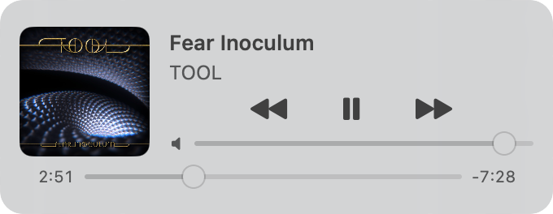
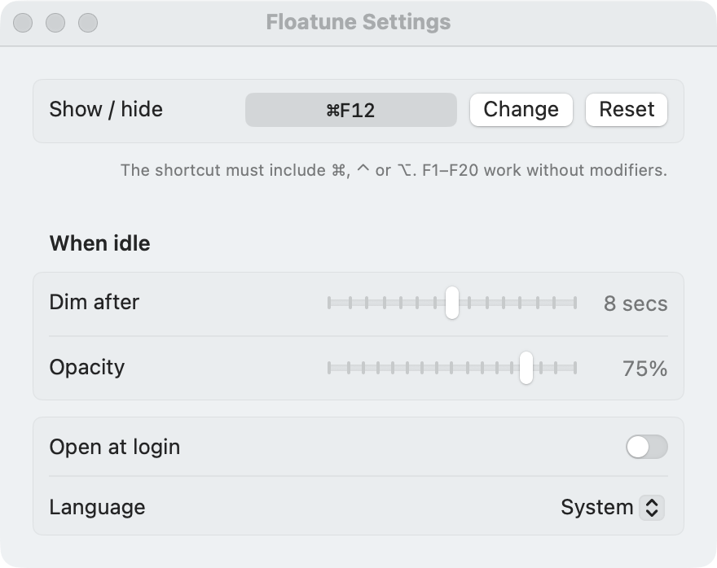

[English](../README.md) | [Русский](README.ru.md) | [Українська](README.uk.md) | [Српски](README.sr.md) | [Hrvatski](README.hr.md) | Română

# Floatune

O fereastră mică pentru controlul Spotify pe macOS. Stă deasupra tuturor ferestrelor, apare și dispare cu o combinație de taste și devine semitransparentă când n-o atingeți.

Fereastra arată coperta, titlul piesei și artistul, butoanele „înapoi”, „pauză” și „înainte”, volumul din Spotify și o bară de progres pe care o puteți trage pentru derulare.

<p>
  
  
</p>

## Cerințe

- macOS 14 sau mai nou
- Aplicația desktop Spotify. Premium nu e necesar.

## Instalare

Descărcați `Floatune-*.zip` din [ultima versiune](https://github.com/azzz/floatune/releases/latest), dezarhivați-l și mutați `Floatune.app` în „Aplicații”.

Aplicația are o semnătură ad-hoc, nu Developer ID, așa că macOS blochează prima lansare. Eliminați marcajul de carantină:

```
xattr -dr com.apple.quarantine /Applications/Floatune.app
```

Sau încercați să deschideți aplicația, apoi apăsați „Deschide oricum” în Configurări sistem → Confidențialitate și securitate.

La prima lansare macOS întreabă dacă Floatune poate controla Spotify. Permiteți. După o actualizare macOS poate întreba din nou, pentru că fiecare build are propria semnătură ad-hoc.

## Utilizare

| Acțiune | Cum |
|---|---|
| Afișează sau ascunde fereastra | ⌃⌥⌘S |
| Readu fereastra estompată la opacitate completă | Treceți cursorul peste ea sau apăsați combinația |
| Mută fereastra | Trageți-o de oriunde. Poziția se salvează |
| Configurări și ieșire | Clic dreapta pe fereastră |

În configurări se schimbă combinația de taste, întârzierea până la estompare (1–15 s), opacitatea ferestrei estompate (10–90%), lansarea la autentificare și limba interfeței. Modificările se aplică imediat, cu excepția limbii, care cere repornire.



Un clic pe fereastră nu ia focusul aplicației în care lucrați.

## Cum funcționează

Floatune comunică cu aplicația desktop Spotify prin Apple Events, aceleași comenzi pe care le folosește AppleScript. Spotify anunță singur schimbarea piesei prin notificarea de sistem `com.spotify.client.PlaybackStateChanged`, deci nimic nu interoghează în fundal. Floatune nu folosește Spotify Web API și accesează internetul doar pentru a descărca copertele.

Limitări:

- Nu există coada pieselor următoare. Doar Web API o oferă, iar acesta cere OAuth și cont de dezvoltator.
- Glisorul schimbă volumul din Spotify, nu pe cel al sistemului.
- Spotify nu trimite notificare la derulare. Cât timp fereastra e vizibilă și o piesă rulează, Floatune recitește poziția la fiecare 5 secunde.
- Dacă Spotify e închis, Floatune nu îl pornește și oferă un buton pentru a-l deschide.

## Limbi

Floatune e tradus în engleză, rusă, ucraineană, sârbă (chirilică), croată și română și urmează limba sistemului. Pentru altă limbă, faceți clic dreapta pe fereastră → „Configurări…” → „Limbă”, apoi apăsați „Repornește”.

### Adăugarea unei limbi

1. Copiați `Resources/en.lproj` în `Resources/<cod>.lproj`, unde `<cod>` e codul limbii: `de`, `pl`, `pt-BR`.
2. Traduceți valorile din `Localizable.strings` și `InfoPlist.strings`. Nu modificați cheile din stânga și păstrați fiecare `%@`.
3. Rulați `python3 scripts/check_strings.py`. Scriptul eșuează dacă lipsește o cheie, există una în plus sau o traducere schimbă `%@`.
4. Construiți aplicația. Limba nouă apare singură în „Configurări” → „Limbă”; alegeți-o și verificați fiecare ecran.

## Compilare din sursă

Ajung Command Line Tools, Xcode nu e necesar.

```
./scripts/build.sh
open build/Floatune.app
```

Scriptul citește aceste variabile de mediu:

| Variabilă | Ce setează | Implicit |
|---|---|---|
| `ARCHS` | Arhitecturi separate prin spațiu, de ex. `"arm64 x86_64"` | Arhitectura Mac-ului dvs. |
| `VERSION` | `CFBundleShortVersionString` | Valoarea din `Resources/Info.plist` |
| `BUILD_NUMBER` | `CFBundleVersion` | Valoarea din `Resources/Info.plist` |
| `SIGN_ID` | Certificatul de semnare | Semnătură ad-hoc |

Gatekeeper nu verifică o aplicație compilată local: macOS pune marcajul de carantină doar pe fișierele descărcate.

## Versiuni

CI verifică traducerile și construiește o aplicație universal la fiecare push în `main` și la fiecare pull request. Pentru a publica o versiune, faceți push la un tag:

```
git tag v0.2.0
git push origin v0.2.0
```

Workflow-ul construiește aplicația cu versiunea din tag și publică un GitHub Release cu arhiva zip.

---

Floatune nu este afiliat cu Spotify AB. Spotify este o marcă înregistrată a Spotify AB.
